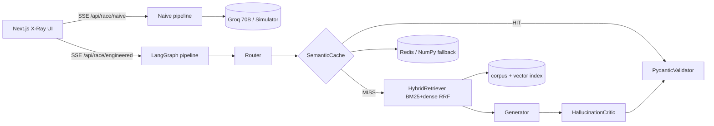

# plan.md — "Naive AI vs. Engineered AI" Live Architecture Race (Aegis)

Status: **APPROVED and IMPLEMENTED (Phases 1-4 complete).** See section 12 at the end for deviations from this plan.

## 0. Environment Findings

| Item | Finding | Implication |
|---|---|---|
| Workspace | Empty git repo (branch `master`, no commits); only `AGENT_PROTOCOL.md` | Greenfield. Protocol says main branch is `main`; I'll rename `master`→`main` on first commit (confirm). |
| Python | 3.14.6 | `onnxruntime` / `fastembed` / `numpy` wheels for 3.14 may be missing. **Plan:** try 3.14 first in a venv; if install fails, use `uv`/`py -3.12` for the venv. Docker image pins 3.12 regardless. |
| Node / npm | 24.21 / 12.2 | Fine for Next.js 15 (App Router). |
| Docker | 29.8.2 | Can validate Milestone 2D builds locally. |
| Redis | Not installed locally | In-memory fallback is the default dev path; Redis tested via compose/Docker only. |
| Playwright MCP | Available | Used in Phase 3 for UI inspection. |
| `GROQ_API_KEY` | Unknown | Demo Mode simulator is first-class; all tests must pass with no key and no network. |

## 1. Architecture



Key design decisions:
1. **Two independent SSE endpoints**, fired concurrently by the browser (`EventSource`-style via `fetch` streaming, so POST bodies work). This makes the "race" real and each side's timer honest.
2. **One `LLMClient` abstraction** with two implementations: `GroqClient` (real) and `SimulatorClient` (deterministic, scripted for the 4 presets, generic fallback for custom queries). Selection is automatic: no key → simulator; Groq 429/5xx/timeout mid-run → fall back to simulator and emit a `fallback` event (never a broken stream).
3. **Simulator fidelity:** streams tokens with realistic per-token delays, and reports token counts/cost with the same accounting as the real path. Simulated runs are labelled `mode: "demo"` in the `meta` event and badged in the UI (honesty about what is live vs. scripted).
4. **Real vs. scripted components:** retrieval, embeddings, RRF, semantic cache, Pydantic validation, and the RAG-triad scoring heuristics are always *real* code. Only the LLM text generation is simulated in demo mode.
5. **Vector store:** default `LocalVectorIndex` (NumPy, persisted to `.cache/`); `PgVectorIndex` selected when `DATABASE_URL` is set. Same `VectorIndex` protocol.
6. **Semantic cache:** `SemanticCache` protocol → `RedisSemanticCache` (when `REDIS_URL` reachable) else `MemorySemanticCache`. Threshold `0.92` cosine on L2-normalized `bge-small` embeddings. Cache key space includes a corpus-version hash so stale answers are invalidated.
7. **Cost model:** `cost = tokens / 1e6 * $15` ("simulated enterprise" rate) for both sides; real Groq prices are shown secondarily in the meta event. 70B vs 8B tier ratio is modelled as 15:1 per the spec.

## 2. Directory Tree

```
aegis-ai-race/
├── AGENT_PROTOCOL.md
├── plan.md
├── README.md                         # Phase 4
├── docker-compose.yml                # 2D (profiles: default, redis, pgvector)
├── .env.example
├── .gitignore
├── .github/workflows/ci.yml          # 2D
├── backend/
│   ├── pyproject.toml                # deps + ruff + pytest config
│   ├── Dockerfile                    # multi-stage, python:3.12-slim, non-root, model pre-warm
│   ├── .dockerignore
│   ├── app/
│   │   ├── __init__.py
│   │   ├── main.py                   # FastAPI app, CORS, lifespan (warm embeddings/index)
│   │   ├── config.py                 # pydantic-settings (env)
│   │   ├── schemas.py                # ALL Pydantic models (§3)
│   │   ├── sse.py                    # event encoder, heartbeat, no-buffer headers
│   │   ├── cost.py                   # token counting + cost accounting
│   │   ├── presets.py                # 4 preset definitions + paraphrase follow-ups
│   │   ├── api/
│   │   │   ├── race.py               # POST /api/race/naive|engineered
│   │   │   ├── kb.py                 # GET /api/kb/documents, /api/kb/documents/{id}
│   │   │   ├── meta.py               # GET /api/health, /api/presets, /api/config
│   │   │   └── cache.py              # POST /api/cache/reset (demo reset)
│   │   ├── llm/
│   │   │   ├── base.py               # LLMClient protocol, TokenChunk
│   │   │   ├── groq_client.py        # httpx streaming, retry, 429 handling
│   │   │   ├── simulator.py          # deterministic scripted streams
│   │   │   └── factory.py            # key/health based selection + fallback wrapper
│   │   ├── rag/
│   │   │   ├── corpus.py             # load/chunk markdown w/ metadata
│   │   │   ├── embeddings.py         # fastembed wrapper (+ hashing-embedder test double)
│   │   │   ├── bm25.py               # rank_bm25 wrapper, tokenizer
│   │   │   ├── vector_index.py       # LocalVectorIndex, PgVectorIndex
│   │   │   ├── hybrid.py             # RRF (k=60) fusion
│   │   │   └── cache.py              # SemanticCache (Redis + Memory)
│   │   ├── pipeline/
│   │   │   ├── naive.py              # Raw prompt -> 70B -> text
│   │   │   ├── graph.py              # LangGraph StateGraph definition
│   │   │   ├── state.py              # GraphState TypedDict
│   │   │   ├── nodes/
│   │   │   │   ├── router.py         # guardrail + complexity score + tier
│   │   │   │   ├── semantic_cache.py
│   │   │   │   ├── retriever.py
│   │   │   │   ├── generator.py
│   │   │   │   ├── critic.py
│   │   │   │   └── validator.py
│   │   │   └── guardrails.py         # injection patterns + sanitizer
│   │   └── eval/
│   │       └── triad.py              # faithfulness, context relevance, schema validity
│   ├── data/
│   │   └── corpus/
│   │       ├── vendor_sla_northwind_cloud.md
│   │       ├── vendor_sla_helix_logistics.md
│   │       ├── invoice_policy_and_credits.md
│   │       ├── cloud_infra_sop_incident_response.md
│   │       ├── cloud_infra_sop_change_management.md
│   │       ├── workforce_scheduling_policy.md
│   │       └── manifest.json         # id, title, category, version
│   └── tests/
│       ├── conftest.py               # forces demo mode + hashing embedder, in-memory cache
│       ├── test_corpus.py
│       ├── test_embeddings_bm25.py
│       ├── test_rrf.py
│       ├── test_semantic_cache.py
│       ├── test_router_guardrails.py
│       ├── test_validator_schemas.py
│       ├── test_triad_eval.py
│       ├── test_graph_flow.py
│       ├── test_sse_endpoints.py
│       └── test_presets_e2e.py       # all 4 presets, both sides, event-order assertions
└── frontend/
    ├── package.json  tsconfig.json (strict, noUncheckedIndexedAccess)
    ├── next.config.ts  tailwind.config.ts  postcss.config.mjs
    ├── Dockerfile  .dockerignore  (standalone output)
    ├── src/
    │   ├── app/  layout.tsx  page.tsx  globals.css
    │   ├── components/
    │   │   ├── ControlBar.tsx  PresetCard.tsx  CustomQuery.tsx  Scoreboard.tsx
    │   │   ├── NaivePanel.tsx  EngineeredPanel.tsx
    │   │   ├── PipelineNode.tsx  PipelineGraph.tsx
    │   │   ├── ResultCard.tsx (per-preset structured cards)  JsonTab.tsx
    │   │   ├── MeterBar.tsx  KnowledgeDrawer.tsx  ModeBadge.tsx
    │   │   └── EmbedShell.tsx
    │   ├── lib/
    │   │   ├── types.ts              # TS mirror of §3 events (discriminated union)
    │   │   ├── sse.ts                # fetch-stream SSE parser w/ AbortController
    │   │   ├── useRace.ts            # reducer-driven state for one side
    │   │   ├── scoreboard.ts         # cumulative savings math
    │   │   └── api.ts
    │   └── __tests__/                # vitest: sse parser, reducer, scoreboard
    └── public/
```

## 3. Pydantic Schemas (`backend/app/schemas.py`)

```python
Side = Literal["naive", "engineered"]
Tier = Literal["8b", "70b"]
Mode = Literal["live", "demo"]

class RaceRequest(BaseModel):
    query: str = Field(min_length=1, max_length=2000)
    preset_id: Literal["hallucination_trap","semantic_cache","tier1_triage","prompt_injection"] | None = None
    variant: Literal["primary","paraphrase"] = "primary"   # paraphrase = cache-race follow-up
    force_demo: bool = False

class TokenUsage(BaseModel):
    prompt_tokens: int; completion_tokens: int
    total: int  # computed
    cost_usd: float   # total/1e6 * 15 * tier_multiplier

class RetrievedChunk(BaseModel):
    chunk_id: str; doc_id: str; doc_title: str; text: str
    dense_score: float | None; bm25_score: float | None
    rrf_score: float; rank: int

class RouterDecision(BaseModel):
    complexity_score: float = Field(ge=0, le=1)
    tier: Tier; model: str
    injection_detected: bool; injection_patterns: list[str]
    sanitized_query: str; reason: str

class CacheLookup(BaseModel):
    hit: bool; similarity: float | None; threshold: float = 0.92
    backend: Literal["redis","memory"]; matched_query: str | None

# --- Structured outputs (Generator -> PydanticValidator) ---
class InvoiceLineFinding(BaseModel):
    line_item: str; billed_usd: Decimal; expected_usd: Decimal
    discrepancy_usd: Decimal; policy_clause: str   # e.g. "SLA §4.2"
class InvoiceAuditCard(BaseModel):
    kind: Literal["invoice_audit"] = "invoice_audit"
    vendor: str; invoice_id: str
    verdict: Literal["compliant","overbilled","underbilled","needs_review"]
    findings: list[InvoiceLineFinding]
    total_discrepancy_usd: Decimal
    citations: list[str] = Field(min_length=1)       # chunk_ids; validator checks they were retrieved
    @model_validator(mode="after")  # sum(findings.discrepancy) == total_discrepancy (the "exact math" check)
class TriageCard(BaseModel):
    kind: Literal["triage"] = "triage"
    category: Literal["billing","outage","access","security","other"]
    priority: Literal["P1","P2","P3","P4"]; summary: str = Field(max_length=200)
    suggested_queue: str
class SecureResponseCard(BaseModel):
    kind: Literal["secure_response"] = "secure_response"
    answer: str; injection_blocked: bool; blocked_patterns: list[str]
    policy_citations: list[str]
class FaqCard(BaseModel):                       # generic custom-query fallback
    kind: Literal["faq"] = "faq"
    answer: str; citations: list[str]; confidence: float = Field(ge=0, le=1)
StructuredCard = Annotated[InvoiceAuditCard|TriageCard|SecureResponseCard|FaqCard, Field(discriminator="kind")]

class TriadScores(BaseModel):
    faithfulness: float; context_relevance: float; schema_validity: float  # 0..1
    context_recall: float | None   # preset-defined expected facts; None for custom queries
    unsupported_claims: list[str]

class CriticVerdict(BaseModel):
    passed: bool; faithfulness: float; flagged_claims: list[str]
    retry_requested: bool   # allows ONE regeneration loop (max 1) before validator
```

## 4. SSE Event Contract

**Transport.** `POST /api/race/{naive|engineered}` with `RaceRequest`; response `text/event-stream`. Headers: `Cache-Control: no-cache, no-transform`, `X-Accel-Buffering: no`, `Connection: keep-alive`. Each frame: `event: <type>\ndata: <json>\n\n`. A `: ping` comment heartbeat every 15 s. Every payload carries `run_id`, `side`, `t_ms` (ms since run start, server clock via `perf_counter`). Stream always ends with `done` or `error`; client abort cancels the generator.

| Event | Side | Payload (beyond common) |
|---|---|---|
| `meta` | both | `mode: Mode`, `query`, `preset_id`, `model`, `fallback_reason: str\|null` |
| `node_start` | eng | `node: "router"\|"cache"\|"retriever"\|"generator"\|"critic"\|"validator"` |
| `node_end` | eng | `node`, `latency_ms`, `status: "ok"\|"skipped"\|"error"`, `data` (typed per node: `RouterDecision` / `CacheLookup` / `{chunks: RetrievedChunk[]}` / `{usage}` / `CriticVerdict` / `{valid: bool, errors: str[]}`) |
| `token` | both | `text`, `completion_tokens` (running), `prompt_tokens`, `cost_usd` (running) — throttled/batched to ≤ 30 frames/s |
| `card` | eng | `card: StructuredCard`, `raw_json: str` |
| `eval` | eng | `TriadScores` |
| `naive_analysis` | naive | `ungrounded_claims: [{span:[start,end], reason}]`, `schema_valid: bool`, `schema_errors: str[]` — computed post-hoc against the same ground truth so the UI can highlight failures on the left |
| `fallback` | both | `reason: "no_key"\|"rate_limited"\|"upstream_error"\|"timeout"`, `switched_to: "demo"` |
| `done` | both | `total_ms`, `usage: TokenUsage`, `cache_hit: bool`, `hallucination_prevented: bool` (eng only: critic flagged and corrected / naive output would fail the check) |
| `error` | both | `code`, `message`, `recoverable: bool` |

Canonical engineered ordering (asserted in tests):
`meta → (node_start/node_end router) → (cache) → [HIT: skip to validator] | [MISS: retriever → generator(token*) → critic → (≤1 retry loop)] → validator → card → eval → done`.
On cache HIT: retriever/generator/critic emit `node_end{status:"skipped"}`, the cached card is re-validated, `done.total_ms` targets ~12 ms.

**Auxiliary REST:** `GET /api/health` · `GET /api/presets` · `GET /api/kb/documents` · `GET /api/kb/documents/{doc_id}` (drawer) · `POST /api/cache/reset` · `GET /api/config` (mode, cache backend, vector backend).

**CORS:** `CORS_ORIGINS` env (default `http://localhost:3000`), explicit origin list, no wildcard with credentials. Frontend calls the backend directly via `NEXT_PUBLIC_API_URL` (a Next rewrite proxy buffers SSE, so we avoid it).

## 5. LangGraph State Machine

`GraphState`: `{query, sanitized_query, router: RouterDecision, cache: CacheLookup, chunks, draft_text, card, critic: CriticVerdict, retries: int, usage, events}`.

```
START → router → cache ──hit──────────────────────────→ validator → END
                   └─miss→ retriever → generator → critic ──pass──→ validator → END
                                          ↑___fail & retries<1___|   (fail & retries==1 → validator w/ flagged annotations)
```
- Router: heuristic complexity score (length, reasoning keywords, numeric/multi-doc cues, classification/format verbs) + injection guardrail; tier threshold 0.5. Injection → query sanitized, `injection_detected` surfaced, still answered safely.
- Nodes push `node_start/node_end/token` events to an `asyncio.Queue` that the SSE generator drains, so the graph streams granularly (via `astream` / custom event queue, whichever tests more cleanly).
- Cache is written only after the validator passes.

## 6. Preset Contracts (what each demo must visibly prove)

| Preset | Naive outcome | Engineered outcome | Test assertion |
|---|---|---|---|
| Hallucination Trap | Confident wrong total (ignores tiered credit / rounding clause) | Retrieves SLA §+invoice policy, critic catches mismatch, `InvoiceAuditCard` with exact discrepancy | `total_discrepancy == sum(findings)`, citations ⊆ retrieved, `hallucination_prevented == true` |
| Semantic Cache Race | ~4–6 s, full tokens twice | Run 1 MISS; paraphrase run HIT ≥ 0.92, <50 ms (target ~12 ms), $0.00 | paraphrase sim ≥ 0.92; second `usage.cost_usd == 0` |
| Tier-1 Triage | 70B, higher cost | Router → 8B, `TriageCard`, ≈1/15 cost | `router.tier == "8b"`; cost ratio ≈ 15× |
| Prompt Injection | Chatty / format broken | `injection_detected`, `SecureResponseCard` valid | schema valid; naive `schema_valid == false` |

Paraphrase pairs are chosen and unit-tested to actually score ≥ 0.92 with the real `bge-small` model (verified at build; if a pair scores lower, the pair is rewritten, never the threshold).

## 7. Corpus & Evaluation

- 6 realistic markdown docs (SLA contracts with numeric credit tiers, invoice/credit policy, infra SOPs, scheduling policy), ~250–600 words each, chunked at ~120–180 tokens with heading-aware splitting; the Hallucination Trap math is derivable only by combining two chunks (which is why hybrid retrieval matters).
- `manifest.json` carries a `version` hash used for cache namespacing and the UI drawer.
- **Triad (heuristic, offline, deterministic):** *Faithfulness* = fraction of answer claims (sentences/numeric facts) supported by retrieved chunks via embedding similarity + numeric-token containment; *Context Relevance* = mean query↔chunk cosine over top-k; *Schema Validity* = Pydantic pass/fail (1.0/0.0). *Context Recall* = fraction of preset's expected facts present in retrieved chunks. With a live key, an optional LLM-judge (8B) can refine faithfulness; off by default to preserve rate limits.

## 8. Frontend Design Notes

- Next.js 15 App Router, TypeScript `strict` + `noUncheckedIndexedAccess`, Tailwind, Framer Motion. Client-only race UI; one `useRace(side)` reducer per panel; both started with a single `Promise.all`-style trigger.
- Layout: sticky control bar (4 preset cards, custom input, **Trigger Semantic Cache Test**, KB drawer toggle, scoreboard) → two equal panels (stack vertically `< lg`). Left: 3-stage single-node strip + timer/tokens/cost + markdown with red highlights from `naive_analysis`. Right: 5 animated nodes with latency badges, HIT/MISS badge, chunk list with RRF scores, card/JSON tabs, Faithfulness & Context-Recall meters.
- Scoreboard: cumulative `Σ(naive_ms − eng_ms)`, `Σ(cost_naive − cost_eng)` at $15/1M, `Σ hallucination_prevented`; persisted in `sessionStorage` (try/catch).
- `?embed=true` → hides header/footer, transparent background, `postMessage` height reporting for iframe auto-resize. `prefers-reduced-motion` respected. Mode badge ("LIVE · Groq" / "DEMO · simulated LLM") always visible.

## 9. Milestones & Test Gates

### 2A — Data, Hybrid RAG & Semantic Cache
Deliver: corpus + manifest, chunker, fastembed wrapper (+ deterministic hashing embedder test double), BM25, `LocalVectorIndex` (+ `PgVectorIndex` behind interface), RRF, `SemanticCache` (Redis + Memory), config.
**Gate:** `pytest backend/tests -k "corpus or embeddings or rrf or semantic_cache"` green, covering: chunk counts/metadata; BM25 finds exact-term queries; dense finds paraphrases; RRF beats each alone on a fixed eval set (recall@5); cache HIT ≥ 0.92 / MISS < 0.92 boundary; Redis path exercised with a fake client + memory fallback on connection failure; `ruff check` clean.

### 2B — LangGraph Engine & FastAPI SSE Server
Deliver: LLM clients + simulator + fallback wrapper, naive pipeline, graph + nodes, guardrails, validator, triad eval, SSE endpoints, KB/meta endpoints, CORS.
**Gate:** `pytest` full green (all 4 presets × both sides, event-order, no-key demo mode, mid-stream Groq failure → `fallback` event, client-disconnect cleanup, schema failure paths, ≥2 concurrent streams); live `curl -N` against `uvicorn` shows incremental frames (timestamps spread, not one burst) for both endpoints; `ruff` clean.

### 2C — Next.js X-Ray UI
**Gate:** `npm run build` ✔, `npx tsc --noEmit` ✔, `npm run lint` ✔, `vitest` (SSE parser, reducer, scoreboard) ✔.

### 2D — MLOps & CI/CD
Deliver: backend/frontend multi-stage Dockerfiles (non-root, healthchecks, embedding model baked in), `docker-compose.yml` (default: backend+frontend; profile `redis`; profile `pgvector` using `pgvector/pgvector:pg16`), `.env.example`, `.github/workflows/ci.yml` (backend: ruff+pytest; frontend: lint+tsc+build+vitest; docker build smoke).
**Gate:** `docker compose config` valid for all profiles; `docker build` succeeds for both images; workflow YAML lints.

### Phase 3 (Critic) checklist
SSE buffering (frames arrive incrementally through `next start` & docker), CORS preflight for POST, Groq 429/timeout handling, strict-TS audit (no `any`), responsive layout at 375/768/1440, embed mode in an `<iframe>`, Playwright runs of all 4 presets, reduced-motion, abort/restart races, console errors.

### Phase 4
README with Mermaid architecture + sequence diagrams, **measured** benchmark table (from `backend/scripts/bench.py` — numbers reported only if actually measured, labelled live vs. demo), env var reference, Vercel (frontend) + Hugging Face Spaces Docker (backend, port 7860) deployment steps, screenshots.

## 10. Risks & Mitigations

| Risk | Mitigation |
|---|---|
| Python 3.14 wheel gaps (onnxruntime/fastembed) | venv on 3.12 via `uv`/`py -3.12`; Docker pins 3.12; document in README |
| fastembed model download on first run (offline/CI) | pre-bake in Docker; tests use hashing embedder fixture; one opt-in `@pytest.mark.model` test for the real model |
| Groq free-tier rate limits | per-IP concurrency cap, retry w/ jitter, automatic demo fallback, visible badge |
| "~12 ms" cache claim | measure it; UI shows the real number whatever it is, and the README reports measured values |
| Hallucination demo must be reproducible with a real LLM | live mode still runs the same retrieval + critic + validator; the *naive* side's failure is verified post-hoc by `naive_analysis`, not assumed |
| Public demo abuse (prompt cost, injection) | 2000-char limit, per-IP rate limit (in-memory token bucket), no tool/network access in the pipeline |
| SSE buffered by proxies (HF Spaces, Vercel) | direct backend URL, no-transform + `X-Accel-Buffering`, heartbeat; verified in Phase 3 |

## 11. Decisions Needed From You

1. **Python:** OK to create the backend venv on Python 3.12 (via `uv` or `py -3.12`) if 3.14 can't install `fastembed`/`onnxruntime`?
2. **Git:** rename `master` → `main` (protocol says main) and commit per milestone?
3. **Rate-limit scope:** in-memory per-IP limiter is fine for a single-instance Space — acceptable, or do you want Redis-backed limiting?
4. **Simulated pricing:** both sides use the spec's flat $15/1M with a 15:1 70B:8B multiplier — acceptable?

Defaults I'll use if you just say "approved": (1) yes, (2) yes, (3) in-memory, (4) yes.

## 12. Implementation notes (deviations from the approved plan)

- **Python 3.12 venv** via `uv` (3.14 lacks onnxruntime wheels); `main` branch; in-memory per-IP rate limiter; flat $15/1M with a 15:1 tier ratio (all four defaults approved).
- **Nodes live in one module** (`pipeline/nodes.py`) rather than a `nodes/` package; `pipeline/streaming.py` (token batching + `EventPump`) and `deps.py` (app context, rate limiter) were added.
- **The critic is deterministic** (numeric derivability, percentage literalness, citation and schema checks), not an 8B LLM call: no extra tokens and no extra rate-limit exposure.
- **Sub-query decomposition** was added to retrieval (each sentence of a long query is also searched and all rankings are RRF-fused); needed so the invoice audit retrieves both the SLA and the audit-policy chunks.
- **Per-session semantic cache** (`session_id`) so visitors cannot pre-warm each other's cache race.
- **Token events** gained a `reset` flag (mid-stream live-to-demo fallback and generator retries); `node_*` events carry `attempt`.
- **The 8B tier retrieves k=2** (k=4 for 70B) to keep simple-task prompts small.
- **Measured, not assumed:** cache HIT median 7.3 ms; simulated naive runs take 2.5-3.9 s (not 4-6 s); the hallucination trap costs the engineered side ~10x more than naive (see README benchmarks).
- **Phase 3 used a standalone Playwright script** because the Playwright MCP server failed to connect: 29 browser checks covering incremental rendering, cache HIT, the embed iframe, 429 and backend-down states, and layouts at 375/768/1440 px.
- **Verified in Docker:** both images build; the full stack with the Redis and pgvector profiles served all presets, with a Redis-backed cache HIT in ~15 ms. This exposed a Postgres start-up race, now retried and logged.
